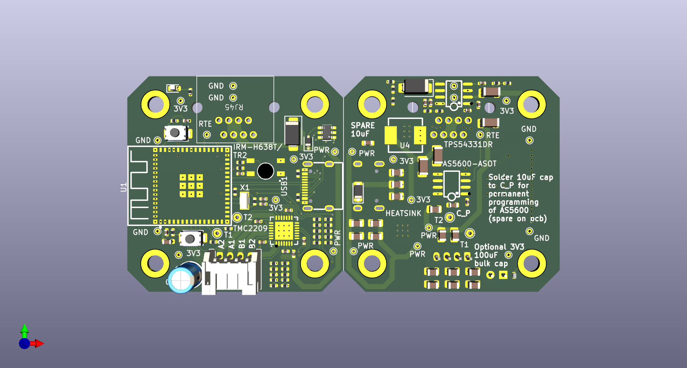
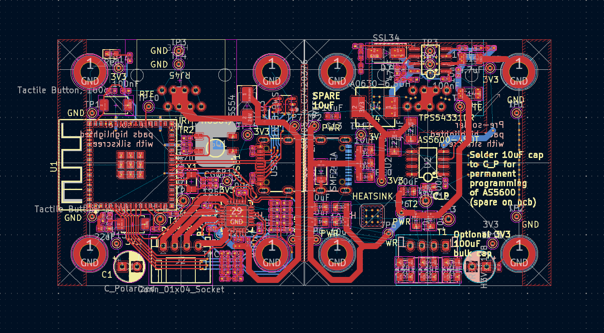
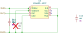
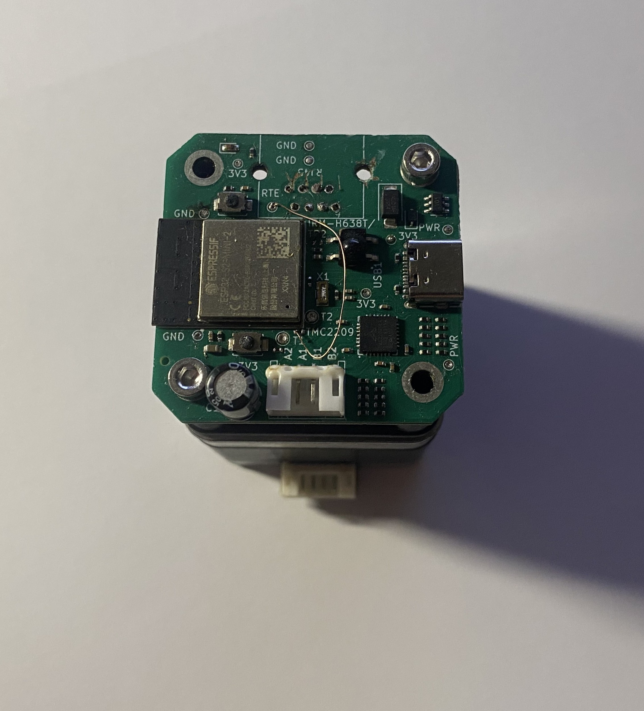

# Wi-Fi-Controlled Stepper Motor Driver Board

As part of an embedded programming coursework, I designed a custom compact Wi-Fi-controlled stepper motor driver board engineered to mount directly onto the back of a NEMA17 motor.

Before the design itself, we were required to submit a small document of what we're about to do (this file is in "study" folder). As always, there were some deviations from the initial plan due to challenges and some poor decisions.

---

## Hardware Overview

* Microcontroller: ESP32-S2-MINI-2-N4
* Stepper Driver: TMC2209-LA-T (featuring UART interface for stallGuard and configuration)
* Shaft Encoder: AS5600-ASOT
* IR Receiver: IRM-H638T-TR2-TL
* Power Supply: 
  * Motor Power: RJ45 connector (testing whether Cat5 cable can be used to bring power to the motor over longer distance than typical USB cable...)
  * Logic Power: USB-C (5V) using a TPS54331DR switching regulator.

---

## Board Renders & Layout

By far the biggest experiment in this project was attempting to have components on both sides of the PCB. At the time of designing this, JLC PCB did not offer double-sided PCBA services. If they do now, I'm sure the cost would persuade me against it. But for all the components I planned to use and still have the PCB fit on the back on a NEMA17 motor, both sides of the board had to be populated.

So I chose a standard PCBA with components soldered to the top side, but the board is designed in such a way, that it is then cut in half and the two halves are glued together and soldered in certain points to connect them together.

The choice of RJ45 connector for delivering power was also strange, but it was something I had on hand and by my calculations, could be used to carry 24V safely, at least at the expected currents.

### Top View

### Bottom View

### Front Layout

---

## Schematics & Subsystems

### Complete System Schematic

  
### Power Connector

  
### Switching Regulator (TPS54331DR)

  
### Stepper Driver (TMC2209)

  
### Shaft Encoder (AS5600)

  
### IR Receiver (IRM-H630T)

  
### External Crystal

---

## Firmware & Logic

The firmware runs on the ESP32-S2, handling:
1. Motor Control: Managed via stepper driver libraries (e.g., [TMCStepper](https://github.com/teemuatlut/TMCStepper)).
2. Position Tracking: Sampling PWM output from the AS5600 magnetic encoder.
3. Communication: Receiving motion commands over Wi-Fi (simple web GUI) and transmitting real-time shaft position and StallGuard values.

---

## Retrospective & Mistakes

This project would need a few more versions before it could be considered a success but it turned out to be a massive learning experience. I improved my soldering skills, because I had to remove some components or bridge certain pads with a wire due to design mistakes. I also had to solder the ESP32 module, because JLC PCB was out of stock on the one I was most familiar with, which is something I've never done before.

Overall, the motor did spin based on commands. It counted steps, tracked shaft position and even returned StallGuard values as it ran. But the torque was low and the assembly itself was frustrating.

* **Double-sided PCB:** Sticking together two PCBs seemed interesting, but caused SO MANY headaches. Even designing it in KiCAD was far more difficult than I expected in the start, and the final assembly was really annoying. I wouldn't repeat it unless absolutely necessary, but it does save space. If I ever decide to do something similar, I should design the through-holes big enough to admit a typical arduino pin that would be pushed through and soldered from both sides, making a very crude via. My through-holes were smaller (again, to save space), and solder didn't want to flow into these tight spaces.

* **The Logic Voltage Drop:** A major oversight involved the reverse current protection on the 5V rail right near the USB-C port. The diode used for this introduced an excessive voltage drop that dragged the voltage down too far below 5V (when it's powered through USB-C only), completely stopping the TMC2209 drivers from functioning until I physically bypassed the diode and shorted the pads on the board. From here I also just used 5V power from the USB-C to power everything, which limited the torque significantly.

Every mistake here taught me a lot more about board bring-up and power distribution than a successful design would have. But overall, I'm not too disappointed with this. Learned quite a bit, got to do a project of my own choosing and passed a class because of it.

## Photos of the assembled board

  <table>
    <tr>
      <td align="center"><b>Corner View</b></td>
      <td align="center"><b>Top View</b></td>
    </tr>
    <tr>
      <td align="center" style="padding: 10px;">
        
      </td>
      <td align="center" style="padding: 10px;">
        
      </td>
    </tr>
  </table>

