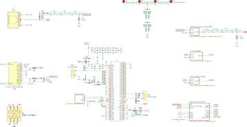
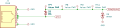
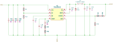
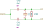

# Wi-Fi-Controlled Stepper Motor Driver Board

A compact, Wi-Fi-enabled controller board designed for NEMA17-style stepper motors featuring integrated shaft position feedback and an unconventional power delivery layout.

---

## Hardware Overview

* Microcontroller: ESP32-S2-MINI-2-N4
* Stepper Driver: TMC2209-LA-T (featuring UART interface for stallGuard and configuration)
* Shaft Encoder: AS5600-ASOT
* IR Receiver: IRM-H638T-TR2-TL
* Power Supply: 
  * Motor Power: RJ45 connector (testing whether Cat5 cable can be used to bring power to the motor over longer distance than typical USB cable...)
  * Logic Power: USB-C (5V) using a TPS54331DR switching regulator.

---

## Board Renders & Layout

Top View

Bottom View

Front Layout

---

## Schematics & Subsystems

### Complete System Schematic

  
### Power Connector

  
### Switching Regulator (TPS54331DR)

  
### Stepper Driver (TMC2209)

  
### Shaft Encoder (AS5600)

  
### IR Receiver (IRM-H630T)

  
### External Crystal

---

## Firmware & Logic

The firmware runs on the ESP32-S2, handling:
1. Motor Control: Managed via stepper driver libraries (e.g., [TMCStepper](https://github.com/teemuatlut/TMCStepper)).
2. Position Tracking: Sampling PWM output from the AS5600 magnetic encoder.
3. Communication: Receiving high-level motion commands and transmitting real-time telemetry (position, error flags, stall conditions) over Wi-Fi.

---

## Retrospective & Mistakes

Truth be told, this ended up being more of a failure project than a polished piece of hardware, but it turned out to be a massive learning experience. 

* **The Power Path:** Using an RJ45 connector for motor power delivery works in a pinch, but it's fundamentally sketchy and definitely not something I'd recommend for standard layouts. 
* **The Logic Voltage Drop:** A major oversight involved the clamping diode on the 5V rail right near the USB-C port. It introduced an excessive voltage drop that dragged the voltage down too far below 5V, completely stopping the TMC2209 drivers from functioning until I physically bypassed the diode and shorted the pads on the board. 

Every mistake here taught me a lot more about board bring-up and power distribution than a successful design would have.

* **The Power Path:** Using an RJ45 connector for motor power delivery[cite: 1] works in a pinch, but it's fundamentally sketchy and definitely not something I'd recommend for standard layouts[cite: 1]. 
* **The Logic Voltage Drop:** A major oversight involved the clamping diode on the 5V rail right near the USB-C port. It introduced an excessive voltage drop that dragged the voltage down too far below 5V, completely stopping the TMC2209 drivers from functioning until I physically bypassed the diode and shorted the pads on the board. 

Every mistake here taught me a lot more about board bring-up and power distribution than a successful design would have.
