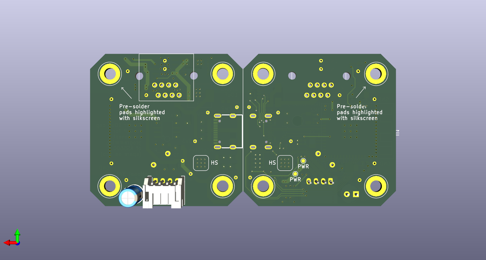
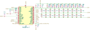
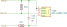
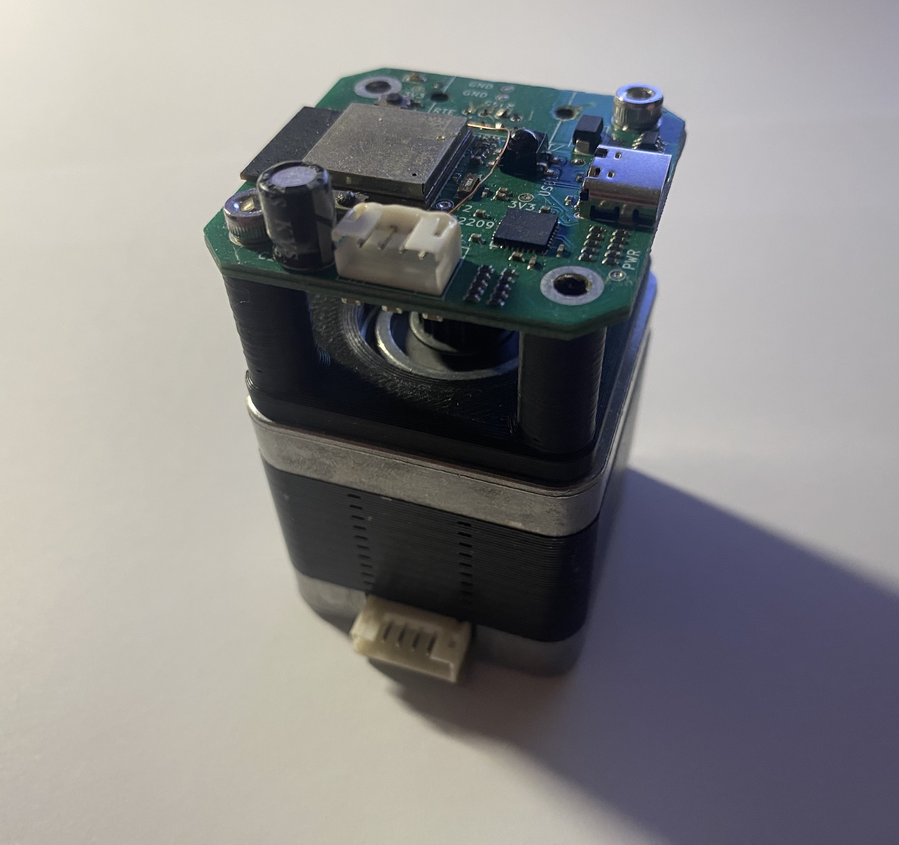

# Wi-Fi-Controlled Stepper Motor Driver Board

As part of an embedded programming coursework, I designed a custom compact Wi-Fi-controlled stepper motor driver board engineered to mount directly onto the back of a NEMA17 motor.

Before the design phase, we were required to submit an initial project proposal (this file is in the "study" folder). As always, there were some deviations from that plan due to unexpected challenges and poor decisions.

---

## Hardware Overview

* Microcontroller: ESP32-S2-MINI-2-N4
* Stepper Driver: TMC2209-LA-T (featuring UART interface for stallGuard and configuration)
* Shaft Encoder: AS5600-ASOT
* IR Receiver: IRM-H638T-TR2-TL
* Power Supply: 
  * Motor Power: RJ45 connector (testing whether a Cat5 cable can be used to supply power to the motor over a longer distance than a typical USB cable)
  * Logic Power: USB-C (5V) using a TPS54331DR switching regulator

---

## Board Renders & Layout

The biggest experiment in this project was attempting to place components on both sides of the PCB. At the time of design, JLCPCB did not offer double-sided PCBA services. While the cost today would likely deter me from this approach, I needed to populate both sides to fit the design onto the back of a NEMA17 motor.

I opted for a standard PCBA with components soldered to the top side, but the board was designed to be cut in half, with the two sections then glued together and soldered at specific points to create electrical connections.

The choice of an RJ45 connector for delivering power was also unconventional, but it was on hand and, by my calculations, could safely carry 24V at the expected currents.

### Top View

### Bottom View

### Front Layout

---

## Schematics & Subsystems

### Complete System Schematic

  
### Power Connector

  
### Switching Regulator (TPS54331DR)

  
### Stepper Driver (TMC2209)

  
### Shaft Encoder (AS5600)

  
### IR Receiver (IRM-H630T)

  
### External Crystal

---

## Firmware & Logic

The firmware runs on the ESP32-S2, handling:
1. Motor Control: Managed via stepper driver libraries (e.g., [TMCStepper](https://github.com/teemuatlut/TMCStepper)).
2. Position Tracking: Sampling PWM output from the AS5600 magnetic encoder.
3. Communication: Receiving motion commands over Wi-Fi via a simple web GUI and transmitting real-time shaft position and StallGuard values.

---

## Retrospective & Mistakes

This project would require a few more iterations to be considered a full success, but it was a significant learning experience. I improved my soldering skills by necessity, having to remove components and bridge pads with wire to correct design errors. I also hand-soldered the ESP32 module, something I had never done before, because JLCPCB was out of stock on the module I was already familiar with.

The motor successfully spun based on commands, counted steps, tracked shaft position, and returned StallGuard values. However, torque was limited and mechanical assembly was tedious.

* **Double-sided PCB:** Sticking together two PCBs seemed interesting, but caused many headaches. Even designing it in KiCad was far more difficult than expected, and the final assembly was tedious. I wouldn't repeat it unless absolutely necessary, though it does save space. If I ever attempt something similar, I should design the through-holes large enough to accommodate a typical Arduino pin that can be pushed through and soldered from both sides to create a crude via. My through-holes were too small, making it difficult for solder to flow into the tight spaces.

* **The Logic Voltage Drop:** A major oversight involved the reverse current protection on the 5V rail near the USB-C port. The diode introduced an excessive voltage drop that dragged the voltage too far below 5V when powered exclusively via USB-C, completely preventing the TMC2209 drivers from functioning until I physically bypassed the diode and shorted the pads. Consequently, I relied entirely on 5V from the USB port, which limited motor torque significantly.

Every mistake taught me far more about board bring-up and power distribution than a flawless design would have. Ultimately, I am satisfied with the result: I learned a great deal, completed an independent project, and passed the class.

## Photos of the Assembled Board

  <table>
    <tr>
      <td align="center"><b>Corner View</b></td>
      <td align="center"><b>Top View</b></td>
    </tr>
    <tr>
      <td align="center" style="padding: 10px;">
        
      </td>
      <td align="center" style="padding: 10px;">
        
      </td>
    </tr>
  </table>

